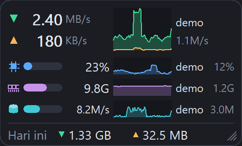
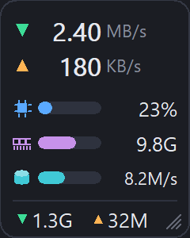
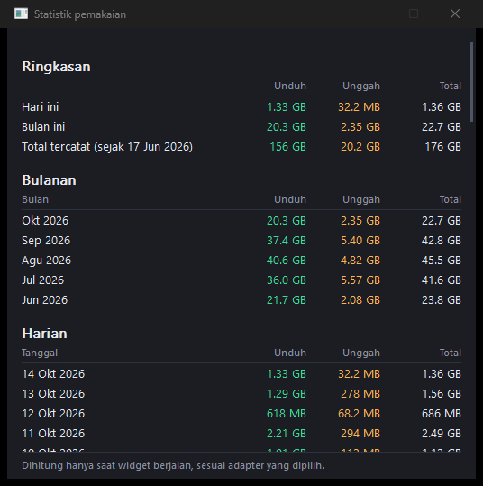

# Resource Widget

Widget Windows mini (ala NetWorx) yang selalu di atas dan menampilkan **kecepatan jaringan ↓/↑, CPU, RAM, dan disk, masing-masing dengan grafik riwayat dan proses teratasnya**, plus pemakaian data hari ini dan jendela statistik harian/bulanan. Tersedia mode ringkas (hanya ikon, bar, dan angka) dan lebar kartu selalu mengikuti kolom yang tampil. Ditulis dengan Rust + `windows-sys` (GDI murni, tanpa framework UI) agar sangat ringan.

## Tampilan

<p align="center">
  
  &nbsp;&nbsp;
  
</p>

<p align="center">
  
</p>

*Gambar kartu dibuat dari data demo sintetis (semua proses bernama `demo`), dan angka pada jendela statistik adalah data contoh; tidak ada data dari mesin penulis.*

## Binary siap pakai

`dist/resource-widget.exe` (Windows 10/11 x64, tanpa instalasi). Cukup jalankan; tidak butuh Rust.

## Build dan jalankan

```powershell
cargo build --release          # hasil: target\release\resource-widget.exe
target\release\resource-widget.exe
```

Butuh Rust (target `x86_64-pc-windows-msvc`) dan VS Build Tools. Exe tidak butuh VC++ Redistributable (CRT di-link statis); satu-satunya dependensi crate adalah `windows-sys`.

Perintah lain:

```powershell
cargo test                     # tes logika (delta counter, format, pengaturan, statistik, proses, registry autostart)
cargo run --example probe -- 10          # cetak metrik dan proses teratas selama 10 dtk (tanpa GUI)
cargo run --example probe -- 10 "Wi-Fi"  # sama, tapi hanya satu adapter
cargo run --release --example screenshot -- demo.bmp 200 [full|noprocs|compact]   # gambar kartu dengan data demo (untuk README)
```

## Membaca kartu

Dari atas ke bawah, tiap baris punya kolom yang sama: **ikon dan bar di kiri, angka, grafik 60 sampel di tengah, proses teratas di paling kanan**. Ikon menggantikan label teks dan berwarna sama dengan bar metriknya.

| Baris | Bar dan angka | Grafik | Proses teratas (kolom kanan) |
|---|---|---|---|
| ↓ / ↑ | kecepatan unduh dan unggah | unduh (area) dan unggah (garis) | proses dengan estimasi trafik terbesar, mis. `msedge 24K/s` |
| chip (CPU) | bar dan `23%` = persen CPU total | persen CPU | proses (digabung per nama) dengan pemakaian CPU terbesar, mis. `claude 3%` |
| keping memori (RAM) | bar = persen RAM terpakai, angka `9.8G` = jumlah terpakai | persen RAM | proses dengan memori privat terbesar, mis. `claude 1.4G` |
| silinder (disk) | bar = **persen waktu aktif disk** (seperti kolom Disk di Task Manager), angka = throughput, mis. `8.2M/s` | persen waktu aktif | proses dengan I/O terbesar, mis. `claude 370K` (per detik) |
| Hari ini | total ↓ dan ↑ hari ini | | |

Nama proses digabung menurut nama image (semua `chrome.exe` dihitung satu aplikasi) dan dipotong dengan "..." bila terlalu panjang. Bar CPU/RAM/disk berubah merah mulai 90 %.

### Mode tampilan dan lebar kartu

Lebar kartu selalu pas dengan kolom yang tampil, tanpa ruang kosong di kanan:

| Mode | Isi | Lebar (skala 100 %) |
|---|---|---|
| Penuh (bawaan) | ikon, bar, angka, grafik, proses teratas | 248 px |
| Proses teratas dimatikan | tanpa kolom proses | 184 px |
| Mode ringkas | hanya ikon, bar, dan angka (total hari ini diringkas) | 120 px |

Saat mode diganti dari menu, kartu menjaga tepi yang paling dekat dengan sisi layar: kartu di separuh kanan layar tetap menempel di tepi kanannya, kartu di separuh kiri tetap di tepi kirinya.

## Pemakaian

- **Geser** kartu dengan drag di mana saja; posisi diingat.
- **Ubah ukuran:** tarik sudut kanan-bawah (ada tanda garis diagonal) untuk memperbesar/memperkecil secara proporsional (50–300 %), atau pilih preset 75 / 100 / 125 / 150 / 200 % dari menu **Ukuran**.
- **Klik kanan** untuk menu: Transparansi, Ukuran, Kecepatan update (0,5 / 1 / 2 / 5 detik), Satuan (Byte/Bit), Adaptor jaringan, Mode ringkas, Proses teratas per metrik (nyala/mati; tidak aktif saat mode ringkas), Statistik pemakaian..., Selalu di atas, Jalankan saat Windows mulai, Keluar. Grafik riwayat selalu 60 sampel, jadi cakupan waktunya mengikuti selang update (60 detik pada 1 detik, 5 menit pada 5 detik).
- **Statistik pemakaian:** klik ganda kartu atau pilih menu **Statistik pemakaian...** untuk membuka jendela berisi ringkasan (hari ini, bulan ini, total), tabel bulanan (24 bulan terakhir), dan tabel harian (90 hari terakhir). Scroll dengan roda mouse atau PgUp/PgDn/Home/End; Esc menutup.
- Mode adapter **Otomatis** menjumlahkan semua adapter *fisik* yang aktif (Ethernet/Wi-Fi). Adapter virtual (WSL/Hyper-V, VPN, filter driver) tidak dihitung agar trafik tidak terhitung ganda. Pilih adapter tertentu dari menu bila ingin memantau yang virtual. Statistik pemakaian mengikuti adapter yang dipilih.
- Byte memakai basis 1024 (KB/s, MB/s), bit memakai basis 1000 (Kbps, Mbps). Total pemakaian selalu dalam byte (basis 1024).
- Satu instance saja; menjalankan lagi akan langsung keluar.

## Data yang disimpan

Di `%APPDATA%\ResourceWidget\`:

| File | Isi |
|---|---|
| `settings.ini` | posisi, transparansi, ukuran (`scale`), selang update (`interval`, ms), satuan, adapter, selalu-di-atas, proses teratas (`procs`), mode ringkas (`compact`) (teks `key=value`) |
| `usage.csv` | total per hari: `YYYYMMDD,byte_masuk,byte_keluar` |

`usage.csv` ditulis tiap 60 detik (bila ada perubahan) dan saat widget ditutup, dengan tulis-lalu-rename agar tidak rusak. Jika proses dimatikan paksa (mis. Task Manager), paling banyak 60 detik terakhir hilang. Menghapus file ini sama dengan mereset statistik.

Jika exe dipindah setelah "Jalankan saat Windows mulai" dinyalakan, matikan lalu nyalakan lagi agar path-nya diperbarui.

## Footprint (terukur di Windows 11, 14 logical CPU, ±450 proses)

| | |
|---|---|
| Ukuran exe | ≈ 313 KB |
| Memori (private working set, angka "Memori" di Task Manager) | ≈ 1 MB; naik sampai ≈ 2 MB hanya selama beberapa milidetik saat pemindaian proses |
| CPU, proses teratas **mati** | ≈ 0,3–8 ms CPU per detik (bervariasi menurut core yang dipakai Windows dan beban sistem) |
| CPU, proses teratas **nyala** | tambahan ≈ 3 ms CPU per detik pada selang 1 detik (≈ 0,02 % dari seluruh CPU) |
| Wakeup | 1 timer per selang update (default 1 detik); tanpa thread atau proses tambahan |

Satu-satunya bagian yang mahal adalah pemindaian proses (`NtQuerySystemInformation`, ≈ 7–8 ms per panggilan di mesin uji). Karena itu ia hanya dijalankan tiap ≈ 5 detik, buffer ±1 MB-nya dilepas setelah tiap pemindaian, dan bisa dimatikan lewat menu **Proses teratas per metrik** untuk kembali ke footprint terkecil. Sampel biasa (jaringan ≈ 0,8 ms, disk dan CPU/RAM jauh di bawah itu) tidak banyak berubah.

EcoQoS dan trim working set sengaja **tidak** dipakai: saat diuji, EcoQoS malah melipatgandakan CPU time (thread berjalan di core hemat daya yang lebih lambat) dan trim hanya kosmetik karena working set kembali naik dalam hitungan detik.

## Keterbatasan

- **Proses teratas jaringan hanyalah perkiraan.** Windows tidak memberi byte jaringan per proses tanpa hak admin. Widget memakai hitungan "Other I/O" per proses (termasuk soket) hanya dari proses yang punya soket TCP/UDP, lalu membatasinya oleh trafik antarmuka. Dalam uji transfer terkontrol prosesnya benar, tetapi proses sistem yang banyak memakai IOCTL (mis. antivirus atau agen keamanan) bisa muncul keliru saat trafik kecil. Nilai disembunyikan bila trafik antarmuka di bawah 256 B/s.
- **Proses teratas disk adalah aktivitas I/O**, bukan byte fisik di disk: hitungan I/O manager per proses ikut menghitung baca/tulis yang dilayani cache. Persen waktu aktif dan throughput disk di baris DSK sendiri berasal dari counter disk fisik (`IOCTL_DISK_PERFORMANCE`, tanpa hak admin) dan mengikuti definisi Task Manager.
- **Statistik hanya mencatat trafik saat widget berjalan.** Trafik ketika widget tertutup atau komputer mati tidak ikut terhitung (tidak seperti layanan latar milik NetWorx).
- **CPU % bisa berbeda dari Task Manager.** Widget memakai `GetSystemTimes` (setara "Processor Time"), sedangkan Task Manager Windows 10/11 memakai "Processor Utility", yang bisa berbeda cukup jauh pada CPU hybrid P/E-core.
- Di bawah beban CPU 100 % yang ekstrem (proses lain menjenuhkan semua core), tick bisa tertunda; angka tetap benar karena kecepatan dihitung dari waktu nyata antar-sampel.
- Widget hanya muncul di virtual desktop tempat ia berjalan (gunakan "Tampilkan jendela ini di semua desktop" dari Task View bila perlu).
- Belum ada: kuota/alert, tray icon, tema.
